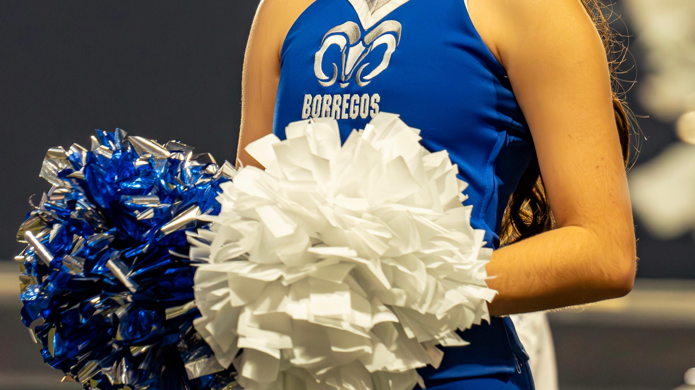
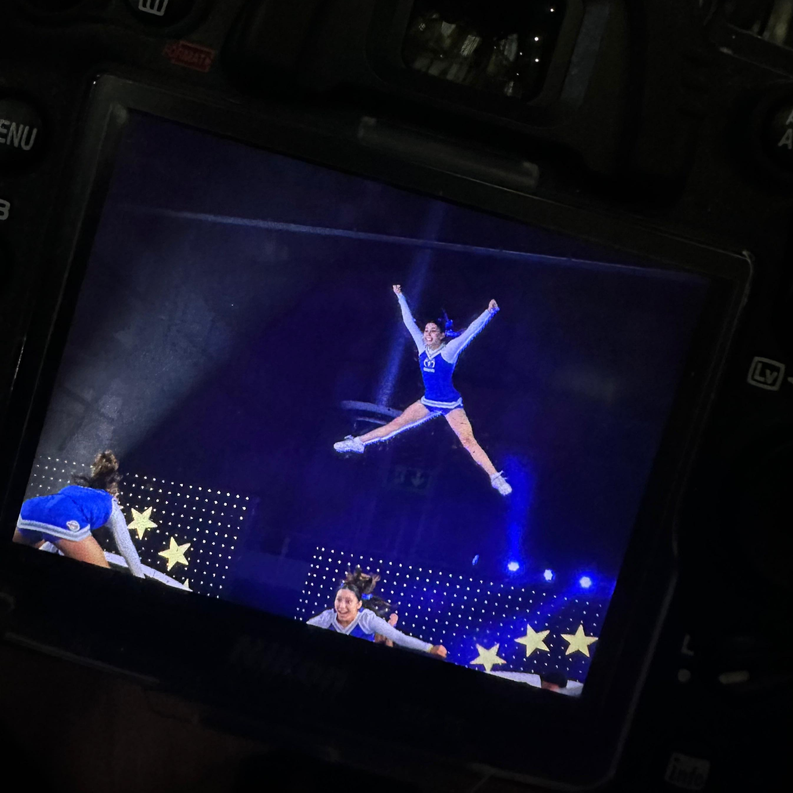
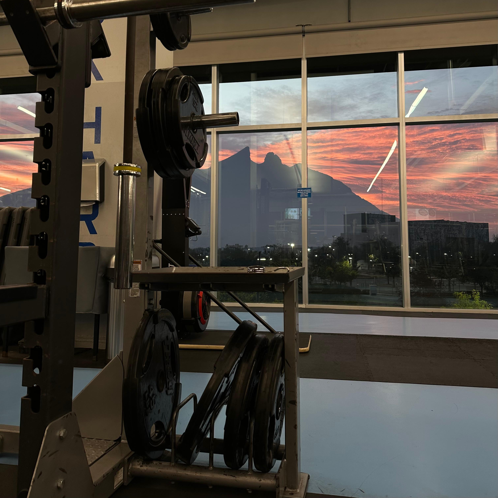
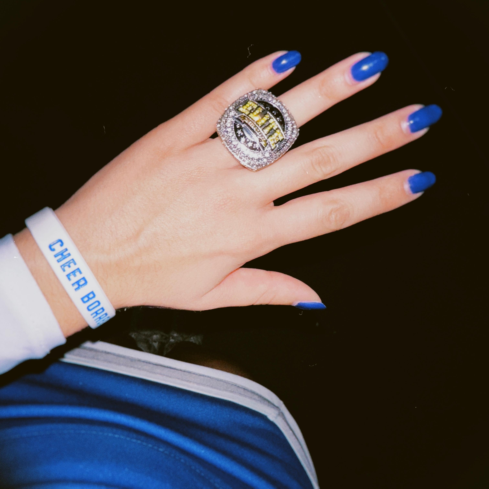
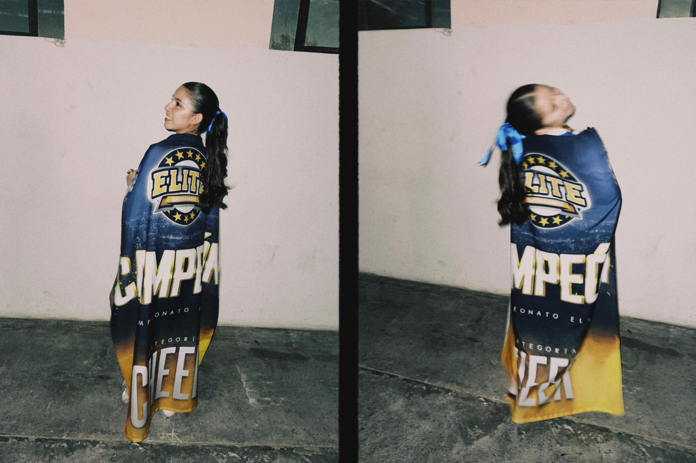

<!-- PORTADA: cambia el nombre del archivo por el de tu foto -->

  

## ✦ abt me

<!-- Tu bio: 2 a 4 líneas, con tu tono -->
just a girl trying to navigate the student-athlete life
- currently working on thermodynamics projects
- learning about AI and how to use it appropriately

## ✦ my skills

  
  
  
  
  

## ✦ stuff i've done

<!-- Copia este bloque por cada proyecto -->
**[Steel Manufacturing Optimization](https://github.com/gabrielatorresrz/Steel-Manufacturing-Optimization)**: thermodynamics project focused on the optimization of time during the batch annealing process of steel coils (still in progress, ignore any weird stuff).

## ✦ g day to day

<!-- GALERÍA: tres fotos en fila; width="32%" hace que quepan juntas -->

  
  
  

## ✦ let's talk!

<!-- Borra el que no quieras usar -->
)

<!-- CIERRE: una última foto

  

-->

<!--
**gabrielatorresrz/gabrielatorresrz** is a ✨ _special_ ✨ repository because its `README.md` (this file) appears on your GitHub profile.

Here are some ideas to get you started:

- 🔭 I’m currently working on ...
- 🌱 I’m currently learning ...
- 👯 I’m looking to collaborate on ...
- 🤔 I’m looking for help with ...
- 💬 Ask me about ...
- 📫 How to reach me: ...
- 😄 Pronouns: ...
- ⚡ Fun fact: ...
-->
